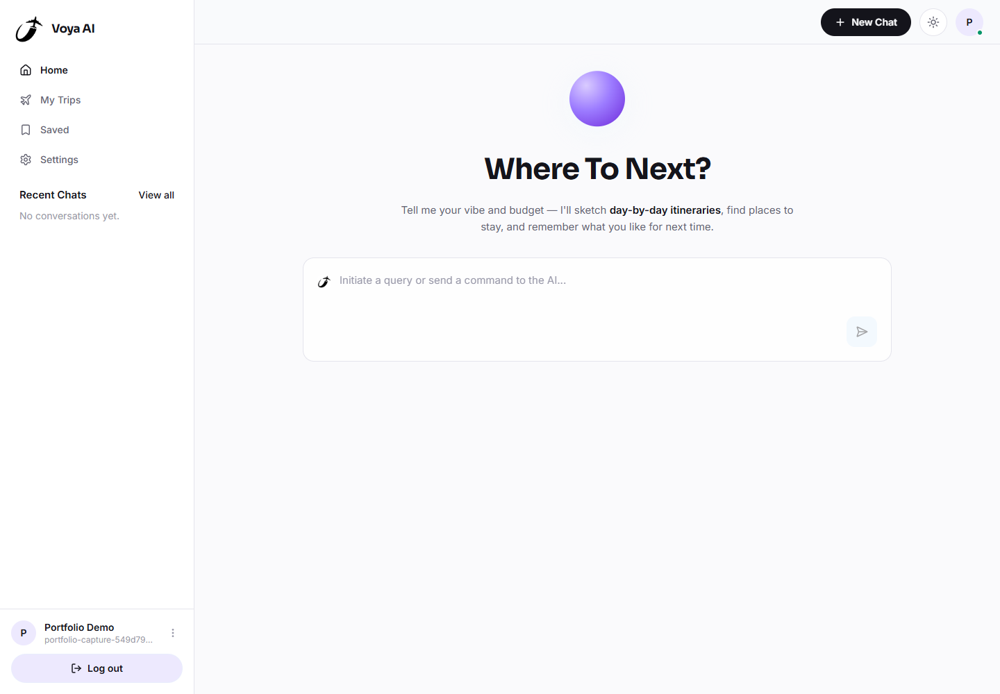
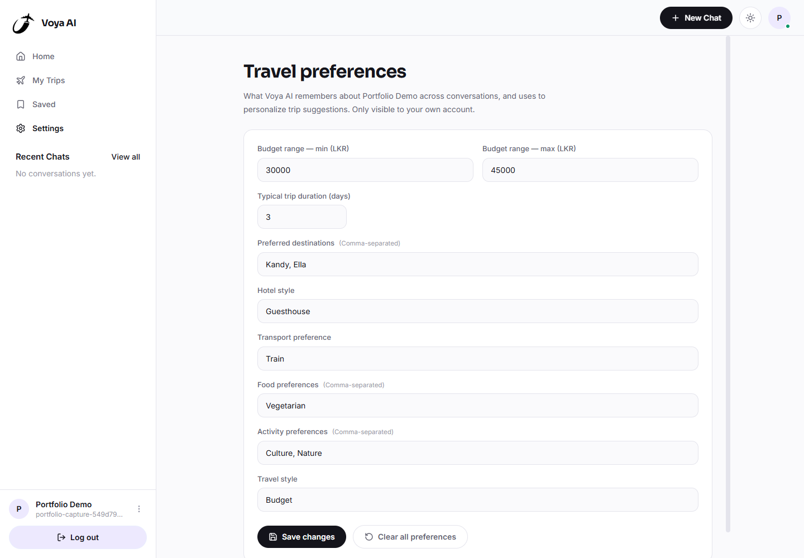
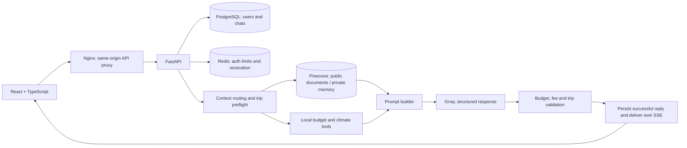

# Voya AI

A Sri Lanka travel assistant that turns a conversation into a day-by-day itinerary, with budget planning, document references and account-specific preferences.

Built as a portfolio project to demonstrate a complete React/FastAPI application: authentication, persistent chat, retrieval-augmented generation (RAG), structured AI output, validation and Docker deployment.

## Preview

Actual screenshots from the local Docker app, using a temporary demo account.





## What it does

- Builds Sri Lanka itineraries and revises them through follow-up messages while preserving trip constraints.
- Retrieves travel-guide and dated timetable passages from Pinecone, then shows friendly source titles.
- Enforces stated total budget caps and calculates a category breakdown with exact arithmetic. Amounts are planning allowances, not booking quotes.
- Discloses assumed starting points, party size, nights and missing travel dates. Unsupported entrance fees and transport claims are checked before display.
- Stores chats in PostgreSQL and restores the selected conversation after login or refresh.
- Keeps saved preferences and persistent vector memory separate for each authenticated account; trip-only instructions can opt out of preference learning.
- Uses JWT session cookies, CSRF checks and Redis-backed authentication limits.
- Reveals validated replies progressively across summaries, itinerary cards and budget tables.

## Run locally with Docker

Requirements: Docker Desktop with Linux containers, Docker Compose **2.30+**, internet access, and your own Groq and Pinecone credentials.

1. From the repository root, copy the example configuration once:

   ```powershell
   if (-not (Test-Path backend/.env)) { Copy-Item backend/.env.example backend/.env }
   ```

   If `backend/.env` already exists, keep it. Set `GROQ_API_KEY`, `PINECONE_API_KEY`, `PINECONE_INDEX_HOST` and a long random `JWT_SECRET_KEY`. Keep values unquoted because Compose uses raw env-file mode. Never commit the completed file.

2. Start the app:

   ```powershell
   docker compose up -d --build
   ```

3. Open **[localhost:8080](http://localhost:8080)** and sign up. Check service readiness with `docker compose ps`. The first build takes longer while dependencies download.

Compose starts Nginx/frontend, FastAPI, PostgreSQL and Redis, including database migrations. It uses a separate Docker database; existing host PostgreSQL accounts and chats are not imported automatically.

### Set up the travel knowledge base

Use a Pinecone index with integrated text embeddings and its field map set to `text`. Supply its host in `PINECONE_INDEX_HOST`. From the repository root, ingest the bundled documents once:

```powershell
docker compose exec backend python -m services.document_ingest docs
```

This writes document vectors to your Pinecone knowledge namespace and can consume its embedding quota. Existing documents are replaced only after new records are uploaded and visible. Startup does not re-ingest documents. Private account memories use separate namespaces.

### Useful commands

```powershell
docker compose ps
docker compose logs -f backend
docker compose down
```

`down` preserves database volumes. Do not use `down -v` if you want to retain accounts and chats. After code changes, run `docker compose up -d --build` again.

| Service | Local address |
| --- | --- |
| App | http://localhost:8080 |
| API health | http://localhost:8000/health |
| API docs | http://localhost:8000/docs |

Ports 8080, 8000 and 6379 must be available. This Compose configuration uses local development credentials and HTTP; a public deployment needs its own secrets and HTTPS configuration. Password-reset emails additionally require Resend configuration.

## Architecture



The normal successful planning path uses **one LLM completion**. Tool arguments for deterministic budget/climate lookups are resolved locally, and places/itinerary generation reuse the existing filtered KB lookup. There is no separate LLM tool-selection request. Validation corrections and recovery can require additional completions.

The prompt retains user instructions, offered options and the newest full itinerary. Older assistant plans retain summaries, trip facts and day titles while repeated source metadata and budget tables are omitted. Validation still receives the original history. Venue-location instructions are included when relevant, and shared budget rules are sent once.

SSE delivers the result, but generated text is held until validation finishes. The visible typing effect is a frontend reveal of that validated reply, so a long answer can still have an initial wait.

## Stack and layout

| Layer | Technologies |
| --- | --- |
| Frontend | React 19, TypeScript, Vite, Tailwind CSS, Zustand, Framer Motion |
| Backend | Python, FastAPI, Pydantic, SQLAlchemy, Alembic |
| Storage | PostgreSQL, Redis, Pinecone |
| AI | Groq (`openai/gpt-oss-120b`), document RAG, deterministic local tools |
| Verification | pytest, Vitest, React Testing Library |
| Runtime | Docker Compose, Nginx |

```text
backend/
  routes/       Auth, preferences and chat APIs
  services/     Retrieval, context routing, AI generation and validation
  db/           Users, conversations and persistence
  docs/         Bundled travel PDFs and reviewed timetable transcription
  tests/        Isolated regressions and external-service integration tests
frontend/
  src/          Chat UI, authentication, settings and state stores
  tests/        Component, store and API-client tests
docs/
  screenshots/  Actual application captures
  engineering.md
docker-compose.yml
```

## Try the conversation flow

Send this in a new chat:

> Plan a 3-day solo trip to Kandy starting from Colombo, with 2 overnight stays. My total budget is LKR 45000, including accommodation, vegetarian meals, transport and activities. Prefer train travel. Show the budget breakdown and disclose assumptions. Do not invent entrance fees.

Then send:

> Make it 2 days with 1 overnight stay. Keep the starting point, destination, food preference, train preference and total budget.

Check that the day count, nights and budget breakdown agree. Log out and back in to check that the conversation is restored. A separate grounding check is:

> What is the current entrance fee for Brief Garden? Give an exact amount only if your available sources verify it. Otherwise say you cannot verify it.

## Tests

Frontend (Node.js 22.12+):

```powershell
cd frontend
npm ci
npm test
npm run build
```

For a focused backend regression run, use the configured Python environment from `backend/`:

```powershell
python -m pytest tests/test_prompt_efficiency.py tests/test_followup_context.py tests/test_generation_recovery.py tests/test_provider_retry.py -q
```

These tests mock generation and retrieval boundaries; they do not spend Groq tokens or write to Pinecone. Backend module imports still require the configured environment and installed dependencies. The full backend suite includes real-service tests that can create test accounts and consume external API quota; run it against a dedicated test environment.

[Engineering notes](docs/engineering.md) cover manual setup, environment variables, ingestion and the validation policies in more detail.

## Known limitations

- **External quotas still apply.** Reducing calls and context saves requests/input, but cannot reset a Groq quota or eliminate HTTP 429 responses. The backend honours provider retry delays, automatically retries short transient failures once, and reports longer cooldowns. Check your provider account quota before a live demo; restarting Docker does not reset it.
- **No live pricing, bookings or weather.** Budget categories are allocations. Entrance fees, transport availability and affordability require confirmation. Climate tools return seasonal reference data.
- **Static, partial knowledge.** The bundled timetable is a partial reviewed transcription of a **2025-12-02** notice, not a live timetable or evidence of a Colombo-Kandy service. Visa rules are not maintained in the KB.
- **RAG and validation have limits.** A source title means a relevant passage was retrieved, not that every generated sentence was verified. Venue-location checks cover a small curated catalogue. Generated plans still need human review.
- **Local deployment scope.** The project demonstrates a working travel-planning workflow; hosting, production operations and a current travel-data service are separate work.
